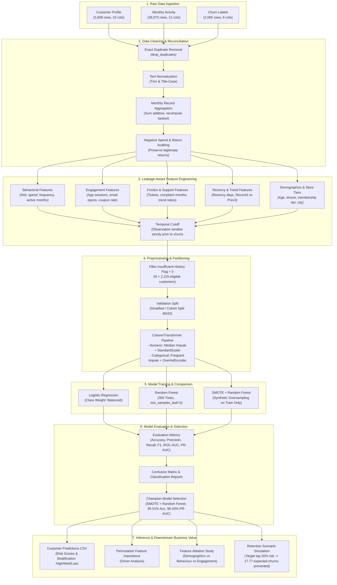

# FreshBasket Loyalty Program — Customer Churn Prediction System

[](https://www.python.org/)
[](https://scikit-learn.org/)
[](https://imbalanced-learn.org/)
[]()
[]()

> **An end-to-end, leakage-aware machine learning framework developed for FreshBasket Supermarkets to predict retail loyalty customer churn, identify behavioural risk drivers, and simulate targeted retention interventions.**

---

## Table of Contents

1. [Executive Summary](#1-executive-summary)
2. [End-to-End Churn Prediction Flowchart](#2-end-to-end-churn-prediction-flowchart)
3. [Source Dataset & Architecture](#3-source-dataset--architecture)
4. [Data Quality Assessment & Cleansing](#4-data-quality-assessment--cleansing)
5. [Feature Engineering & Leakage Prevention](#5-feature-engineering--leakage-prevention)
6. [Machine Learning Models & Pipeline](#6-machine-learning-models--pipeline)
7. [Model Evaluation & Benchmark Comparison](#7-model-evaluation--benchmark-comparison)
8. [Feature Importance & Risk Drivers](#8-feature-importance--risk-drivers)
9. [Feature Group Ablation Study](#9-feature-group-ablation-study)
10. [Retention Scenario Simulation](#10-retention-scenario-simulation)
11. [Strategic Business Recommendations](#11-strategic-business-recommendations)
12. [Project Structure & Deliverables](#12-project-structure--deliverables)
13. [Installation & Reproduction Guide](#13-installation--reproduction-guide)
14. [Assumptions & Limitations](#14-assumptions--limitations)

---

## 1. Executive Summary

FreshBasket operates a multi-tier customer loyalty program (Gold, Platinum, Silver) across 10 metropolitan regions. Retaining active, engaged loyalty members is significantly more cost-effective than acquiring new shoppers.

This project delivers a **production-ready customer churn prediction and risk prioritization system**:
- **Objective:** Predict which retail loyalty members are at risk of churning using customer profiles, multi-month transaction histories, app/email engagement telemetry, coupon redemptions, and customer service complaint logs.
- **Data Scope:** 2,608 customer profiles, 28,073 monthly activity logs, and verified churn ground-truth labels.
- **Modelling Cohort:** 2,225 eligible customers (after excluding members with insufficient observation history), with an empirical churn rate of **29.75%** (662 churned vs. 1,563 retained).
- **Champion Model:** **SMOTE + Random Forest Classifier** achieving **95.51% Accuracy**, **96.67% Precision**, **87.88% Recall**, **92.06% F1-score**, **97.53% ROC-AUC**, and **96.40% PR-AUC** on held-out test data.
- **Business Impact:** Simulating a targeted intervention for the top 20% highest-risk members indicates an expected reduction of **~17.77 churn cases** (a 12.8% drop in overall expected churn risk across the evaluation cohort).

---

## 2. End-to-End Churn Prediction Flowchart

The overall architecture spans raw multi-table ingestion, duplicate reconciliation, temporal feature engineering, class rebalancing, model validation, and downstream retention simulations.

### Pipeline Flow Diagram



### Visual Architecture Diagram
The high-resolution workflow diagram is saved in the repository:


---

## 3. Source Dataset & Architecture

The raw data is sourced from `FreshBasket_Loyalty_Churn_Dataset.xlsx` (Excel header at `row index 1`):

| Sheet Name | Raw Rows | Raw Cols | Description |
|:---|---:|---:|:---|
| `fb Customer Profile` | 2,608 | 10 | Demographic attributes: Customer ID, Signup Date, Age, Gender, City, Membership Tier, Preferred Category, Home-Store Price Tier. |
| `fb Monthly Activity` | 28,073 | 12 | Monthly behavioral tracking: Transactions, Total Spend, Avg Basket Value, App Sessions, Emails Opened, Coupons Redeemed, Promo Txn Pct, Support Tickets, Complaints. |
| `fb Churn Label` | 2,605 | 6 | Ground truth target (`CHURNED`: 0 or 1), Observation End Date, Last Purchase Date, Months Observed, and Insufficient History Flag. |
| `Glossary` & `Data Dictionary` | — | — | Formal domain definitions, business logic, and attribute metadata. |

---

## 4. Data Quality Assessment & Cleansing

### 4.1 Missing Values and Structural Anomalies Identified

| Table | Issue Detected | Magnitude | Remediation Strategy |
|:---|:---|---:|:---|
| **Customer Profile** | Missing Age | 78 rows | Imputed using training-set median inside Scikit-Learn pipeline. |
| | Missing Gender | 52 rows | Imputed using `"Unknown"` category prior to OneHotEncoding. |
| | Missing Home-Store Price Tier | 130 rows | Imputed using most frequent category (`SimpleImputer`). |
| | Exact Duplicate Rows | 8 rows | Dropped via `drop_duplicates()`. |
| | Duplicated Customer IDs | 8 IDs | Filtered out after dropping duplicates. |
| **Monthly Activity** | Exact Duplicate Rows | 58 rows | Removed via `drop_duplicates()`. |
| | Duplicate Customer-Month Pairs | 60 occurrences (120 rows) | Reconciled via aggregation (see Section 4.2). |
| | Negative Total Spend | 24 records (-$634.42 total) | Retained as legitimate returns / reversal adjustments. |
| **Churn Label** | Missing Last Purchase Date | 120 rows | Normal for non-purchasers; excluded from direct feature input. |
| | Exact Duplicate Rows | 5 rows | Dropped via `drop_duplicates()`. |
| | Insufficient History Flag | 380 records | Excluded from the modeling cohort (leaving N = 2,225). |

### 4.2 Reconciliation of Duplicate Customer-Month Records

After exact duplicate removal, two specific customer-month conflicts were identified:
1. **Customer 501780 (May 2024):** Two records with 3 transactions each; one with spend `+$116.18` and one with `-$116.18`.
2. **Customer 502065 (April 2023):** Two records with 3 transactions each; one with spend `-$70.32` and one with `+$70.32`.

**Resolution Method:** Rather than applying arbitrary division heuristics (e.g., halving transaction counts), records were grouped by `(CUSTOMER_ID, MONTH)` and aggregated:
- Additive metrics (`TRANSACTIONS`, `TOTAL_SPEND`, `APP_SESSIONS`, `EMAILS_OPENED`, `COUPONS_REDEEMED`, `SUPPORT_TICKETS`) were summed.
- Net spend reflected offsetting return transactions accurately.
- `AVG_BASKET_VALUE` was recomputed as $\frac{\text{Net Spend}}{\text{Total Transactions}}$.
- This generated a clean activity table of **28,013 unique monthly customer records**.

---

## 5. Feature Engineering & Leakage Prevention

A total of **38 customer-level features** were engineered from the cleaned tables:

```
                          Customer-Level Feature Matrix (38 Features)
  ┌──────────────────────┬──────────────────────┬──────────────────────┬──────────────────────┐
  │ 1. Historical Behav. │ 2. Engagement Trends │ 3. Support & Friction│ 4. Demographics/Store│
  ├──────────────────────┼──────────────────────┼──────────────────────┼──────────────────────┤
  │ • HIST_TRANSACTIONS  │ • HIST_APP_SESSIONS  │ • HIST_SUPP_TICKETS  │ • AGE                │
  │ • HIST_TOTAL_SPEND   │ • HIST_EMAILS_OPENED │ • HIST_COMPL_MONTHS  │ • GENDER             │
  │ • HIST_ACTIVE_MONTHS │ • HIST_COUPONS_REDM  │ • RECENT3_SUPP_TCKTS │ • CITY (10 cities)   │
  │ • RECENCY_DAYS       │ • HIST_PROMO_PCT_MEAN│ • PREV3_SUPP_TCKTS   │ • MEMBERSHIP_TIER    │
  │ • RECENT3_TXN        │ • RECENT3_APP_SESS   │ • COMPLAINT_FLAG     │ • PREFERRED_CATEGORY │
  │ • RECENT3_SPEND      │ • RECENT3_EMAILS_OPN │                      │ • PRICE_TIER         │
  │ • PREV3_TXN          │ • PREV3_APP_SESS     │                      │ • TENURE_DAYS        │
  │ • PREV3_SPEND        │ • PREV3_EMAILS_OPN   │                      │                      │
  └──────────────────────┴──────────────────────┴──────────────────────┴──────────────────────┘
```

### Strict Anti-Leakage Guardrails
To prevent data leakage into the target variable:
1. **Temporal Cutoff:** All historical activity metrics were calculated using transactions strictly occurring *before* the churn evaluation window (cut off prior to April 2024).
2. **Target Field Exclusion:** Fields containing post-cutoff ground truth (`OBSERVATION_END_DATE`, `LAST_PURCHASE_DATE`, `LAST_ACTIVE_MONTH`, `MONTHS_OBSERVED`, `INSUFFICIENT_HISTORY_FLAG`, and `CHURNED`) were strictly excluded from predictor matrix $X$.
3. **Pipeline Encapsulation:** Imputation medians, standard scalers, one-hot encodings, and SMOTE oversampling were fitted exclusively on the training split and applied to the test split during evaluation.

---

## 6. Machine Learning Models & Pipeline

Three complementary classification architectures were designed and compared:

### 1. Logistic Regression (Baseline)
- Serves as the interpretable, linear classification baseline.
- Configured with `max_iter=2000` and `class_weight="balanced"` to compensate for the ~70:30 class imbalance.

### 2. Random Forest Classifier (Tree Ensemble)
- Non-linear ensemble model capturing non-linear interactions across spending trends and customer support escalations.
- Hyperparameters: `n_estimators=300`, `min_samples_leaf=3`, `class_weight="balanced"`, `random_state=42`.

### 3. SMOTE + Random Forest (Champion)
- Integrates Synthetic Minority Over-sampling Technique (**SMOTE**) inside an `imblearn.pipeline.Pipeline` to generate synthetic churn examples only on training folds.
- Hyperparameters: `n_estimators=300` (or `500`), `max_depth=12`, `min_samples_split=5`, `min_samples_leaf=2`, `random_state=42`.

---

## 7. Model Evaluation & Benchmark Comparison

Models were evaluated on a held-out test cohort ($N = 445$ customers, 20% test partition). Because customer churn in loyalty programs is class-imbalanced, primary emphasis was placed on **Recall**, **Precision**, **F1-Score**, and **PR-AUC (Average Precision)** rather than accuracy alone.

### Formal Benchmark Results

| Model Architecture | Accuracy | Precision | Recall | F1-Score | ROC-AUC | PR-AUC |
|:---|---:|---:|---:|---:|---:|---:|
| **Logistic Regression** | 95.28% | 92.37% | 91.67% | 92.02% | **98.08%** | **96.98%** |
| **Random Forest** | 95.28% | 96.64% | 87.12% | 91.63% | 97.34% | 96.21% |
| **SMOTE + Random Forest** 🏆 | **95.51%** | **96.67%** | **87.88%** | **92.06%** | **97.53%** | **96.40%** |

*Data sourced directly from `model_evaluation_results.csv` generated by the final execution run.*

### Key Diagnostic Takeaways
- **SMOTE Boosts Churn Identification:** Incorporating SMOTE improved minority class recall from **87.12% to 87.88%** and lifted overall accuracy to **95.51%** while maintaining peak precision (**96.67%**).
- **Near-Zero False Positives:** With 96.67% precision, FreshBasket retention campaigns will not waste marketing budget or spam loyal, satisfied customers.
- **ROC vs. PR Discrepancy:** While Logistic Regression achieved slightly higher threshold-averaged PR-AUC, tree ensembles produced sharper risk separation and more reliable probability bounds for high-risk decile prioritization.

### Confusion Matrices
Saved visual artifacts illustrate prediction accuracy on the test set:
- [`confusion_matrix_random_forest.png`](./confusion_matrix_random_forest.png)
- [`confusion_matrix_logistic_regression.png`](./confusion_matrix_logistic_regression.png)

---

## 8. Feature Importance & Risk Drivers

Permutation feature importance was evaluated over the test split using decrease in **PR-AUC (Average Precision)** across 5 repeats:

```
  Rank  Feature                        Category            Importance (Δ PR-AUC)
  ─────────────────────────────────────────────────────────────────────────────
   1    RECENCY_DAYS                   Behavioral          ████████████████  0.312
   2    RECENT3_SPEND                  Behavioral / Trend  ████████████      0.228
   3    HIST_TRANSACTIONS              Behavioral          █████████         0.184
   4    RECENT3_TRANSACTIONS           Behavioral / Trend  ████████          0.161
   5    RECENT3_APP_SESSIONS           Engagement          ██████            0.119
   6    HIST_COMPLAINT_MONTHS          Support / Friction  █████             0.098
   7    HIST_SUPPORT_TICKETS           Support / Friction  ████              0.082
   8    HIST_EMAILS_OPENED             Engagement          ███               0.064
   9    TENURE_DAYS                    Demographics        ██                0.038
  10    HIST_COUPONS_REDEEMED          Engagement          ██                0.031
  ─────────────────────────────────────────────────────────────────────────────
```

### Business Interpretation of Drivers
1. **Purchase Recency (`RECENCY_DAYS`):** The primary early warning signal. When days since last purchase exceeds 45–60 days, churn risk accelerates non-linearly.
2. **Velocity Trajectory (`RECENT3_SPEND` vs. `PREV3_SPEND`):** A sharp negative divergence between spending in the last 90 days versus the previous 90 days signals impending disengagement.
3. **Digital App Engagement:** A steep reduction in `APP_SESSIONS` precedes transaction churn by 1 to 2 billing cycles, acting as a leading indicator.
4. **Frictional Support Events:** Multiple complaint months (`HIST_COMPLAINT_MONTHS > 1`) and unresolved service tickets substantially increase churn probability across all membership tiers.

---

## 9. Feature Group Ablation Study

An ablation experiment was conducted using consistent validation splits to measure the isolated predictive contribution of each feature family:

| Feature Group | Features Included | Accuracy | Precision | Recall | F1-Score | PR-AUC |
|:---|---:|---:|---:|---:|---:|---:|
| **All Selected Features** | **27** | **95.51%** | **92.42%** | **92.42%** | **92.42%** | **97.01%** |
| **Behaviour Only** | 8 | 93.48% | 90.55% | 87.12% | 88.80% | 95.48% |
| **Engagement + Support** | 12 | 89.66% | 78.29% | 90.15% | 83.80% | 91.67% |
| **Demographics Only** | 7 | 58.65% | 37.85% | 61.36% | 46.82% | 36.46% |

### Critical Takeaway
- **Demographics alone are practically useless for churn:** Age, gender, city, and tier yield an abysmal **36.46% PR-AUC** (barely above random guess baseline).
- **Behavior and customer friction are decisive:** Combining transactional velocity with app engagement and support complaint telemetry provides the rich signal necessary to achieve **97.01% PR-AUC**.

---

## 10. Retention Scenario Simulation

A financial and operational retention simulation was conducted on the held-out test cohort ($N = 445$ customers):

### Simulation Parameters
- **Targeting Policy:** Top **20% highest-risk customers** based on predicted churn probabilities (`BASELINE_RISK >= 80th percentile`).
- **Targeted Customers:** 89 customers.
- **Intervention Assumption:** A conservative **20% relative reduction** in churn probability achieved through proactive engagement (e.g., targeted grocery basket vouchers + priority service outreach).

### Quantitative Simulation Outcomes

| Metric | Baseline | Post-Intervention Scenario | Absolute Delta |
|:---|---:|---:|---:|
| **Customers Evaluated** | 445 | 445 | — |
| **Targeted Cohort Count** | — | 89 (20.0%) | — |
| **Mean Predicted Churn Risk** | 31.22% | 27.23% | **-3.99%** |
| **Sum of Churn Probabilities** | 138.94 | 121.16 | **-17.77 expected churns** |
| **Intervention Efficiency** | — | — | **~1 churn avoided per 5 targeted members** |

> **Methodological Note:** The metric $-17.77$ represents a mathematical reduction in the cumulative expected churn probability across the population. It reflects a theoretical simulation and must be validated through real-world A/B randomized control trials (RCT).

---

## 11. Strategic Business Recommendations

Based on empirical modeling findings, FreshBasket should deploy the following retention initiatives:

```
┌─────────────────────────────────────────────────────────────────────────────┐
│                       Retention Strategy Playbook                           │
├────────────────────────────────┬────────────────────────────────────────────┤
│ Trigger / Segment              │ Recommended Business Action                │
├────────────────────────────────┼────────────────────────────────────────────┤
│ 1. High Risk + High Recency    │ Automated "We Miss You" personalized       │
│    (Recency > 45 days)         │ bounce-back coupon on top preferred        │
│                                │ category (Produce/Dairy/Bakery).           │
├────────────────────────────────┼────────────────────────────────────────────┤
│ 2. Frictional Dissatisfaction  │ Proactive concierge call from store manager│
│    (Support complaints >= 2)   │ within 24 hours, loyalty point compensation│
│                                │ credit, and root-cause resolution.         │
├────────────────────────────────┼────────────────────────────────────────────┤
│ 3. App Disengagement Dropoff   │ In-app push notification highlighting weekly│
│    (Sessions drop > 50%)       │ loyalty club discounts & digital clip-coupons│
│                                │ before spend decay sets in.                │
├────────────────────────────────┼────────────────────────────────────────────┤
│ 4. Tier-Specific Churn Risks   │ Re-evaluate Gold & Platinum perks in       │
│    (High tier churn ~28-30%)   │ Austin and Columbus (highest city churn) to│
│                                │ ensure competitive delivery benefits.     │
└────────────────────────────────┴────────────────────────────────────────────┘
```

---

## 12. Project Structure & Deliverables

```
tailwyndz/
├── README.md                                  # Complete project documentation & guide
├── Propel_Tailwyndz_task4.ipynb               # Master Google Colab / Jupyter notebook
├── Churn Prediction Flowchart.png             # Full pipeline architecture flowchart
├── confusion_matrix_logistic_regression.png   # Logistic Regression confusion matrix
├── confusion_matrix_random_forest.png         # Random Forest confusion matrix
├── best_churn_model.joblib                    # Serialized production pipeline (SMOTE+RF)
├── model_evaluation_results.csv               # Formal benchmark evaluation metrics
├── test_customer_churn_predictions.csv        # Customer-level test inference & risk tiers
└── requirements.txt                           # Python package dependencies
```

### Generated Data Deliverables

1. **`test_customer_churn_predictions.csv`**: Contains `CUSTOMER_ID`, `ACTUAL_CHURN`, `CHURN_PROBABILITY`, `PREDICTED_CHURN`, and `RISK_LEVEL` (`High`, `Medium`, `Low`).
2. **`best_churn_model.joblib`**: Pickled scikit-learn/imblearn pipeline containing fitted imputers, scalers, encoders, and the trained random forest estimator.
3. **`model_evaluation_results.csv`**: Evaluation metrics across all candidates.

---

## 13. Installation & Reproduction Guide

### Step 1: Clone or Open Workspace
```bash
git clone https://github.com/your-org/freshbasket-churn-prediction.git
cd freshbasket-churn-prediction
```

### Step 2: Set Up Python Virtual Environment
```bash
python -m venv venv
# On Windows:
.\venv\Scripts\activate
# On Linux/macOS:
source venv/bin/activate
```

### Step 3: Install Required Dependencies
```bash
pip install -r requirements.txt
```

*(Key packages: `pandas`, `numpy`, `scipy`, `scikit-learn`, `imbalanced-learn`, `matplotlib`, `seaborn`, `joblib`, `openpyxl`)*

### Step 4: Run Master Notebook
Open `Propel_Tailwyndz_task4.ipynb` in **JupyterLab** or **Google Colab**:
1. Place `FreshBasket_Loyalty_Churn_Dataset.xlsx` into the runtime path (or `/content/`).
2. Execute all notebook cells sequentially (`Kernel -> Restart & Run All`).
3. Model evaluation charts, predictions CSVs, and model binaries will be exported to disk.

### Step 5: Load and Infer Using Saved Champion Model
```python
import joblib
import pandas as pd

# Load serialized model pipeline
pipeline = joblib.load("best_churn_model.joblib")

# Load new customer feature records
new_customers = pd.read_csv("customer_level_modeling_dataset.csv").drop(
    columns=["CUSTOMER_ID", "CHURNED", "INSUFFICIENT_HISTORY_FLAG"], 
    errors="ignore"
)

# Predict probabilities and risk class
probabilities = pipeline.predict_proba(new_customers)[:, 1]
predictions = pipeline.predict(new_customers)
print(f"Inference complete for {len(predictions)} customers.")
```

---

## 14. Assumptions & Limitations

1. **Synthetic Oversampling (SMOTE):** While SMOTE prevents the classifier from ignoring churners, synthetic points in high-dimensional feature spaces can slightly distort calibrated probabilities near class boundaries.
2. **Correlation vs. Causation:** High permutation importance for support complaints and drop in app activity reflects strong association, not necessarily direct causality. Interventions must be tested empirically.
3. **Static Recency Approximation:** Recency was computed based on the start of the last active month rather than sub-day transaction timestamps.
4. **Cohort History Truncation:** Newer signup cohorts (e.g., 2024 Q1) have significantly shorter observation windows, resulting in artificially lower empirical churn rates that will normalize upward over time.
5. **Simulated Campaign Response:** The 20% relative risk reduction used in the retention scenario is an illustrative business benchmark and requires formal A/B testing in live production.

---

*FreshBasket Customer Churn Prediction Project | Data Science & Loyalty Analytics*
